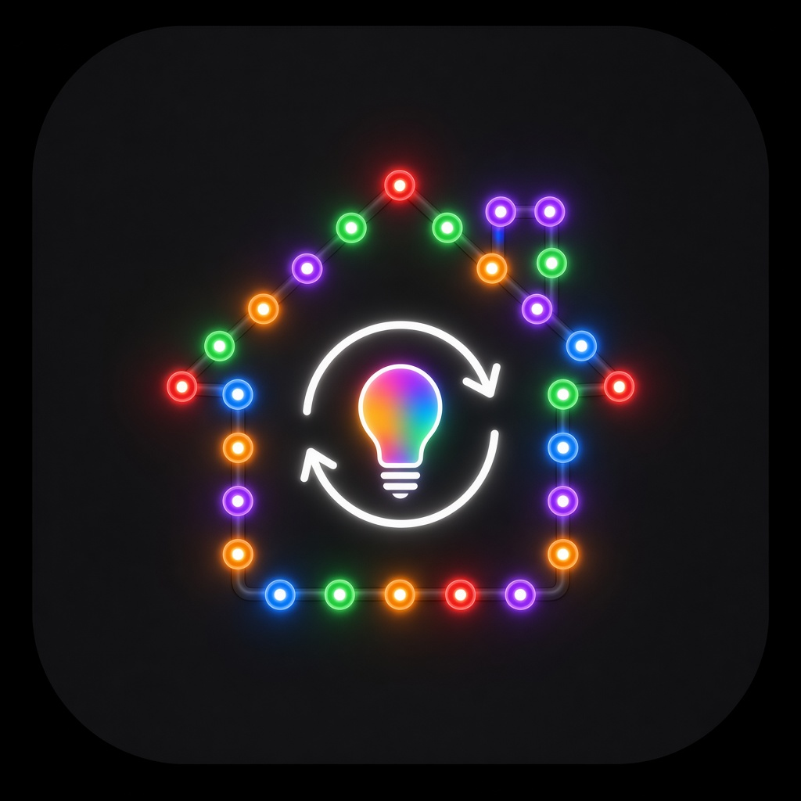

# GlowCast

Home Assistant custom integration that syncs **existing** lights (Hue, Zigbee, Govee via BLE add-on, Wi-Fi bulbs, etc.) into themed, animated color shows with holiday presets.

GlowCast never talks to bulbs directly — it only calls `light.turn_on` / `light.turn_off` on entities already in Home Assistant.

## Features

- **UI config flow** (no YAML) + options flow
- Auto-creates a **room** for every HA area that contains lights, plus **All lights**
- Lights added to an area later join automatically (entity registry listener)
- Custom groups by picking lights (options flow)
- Per room: theme select, show switch, speed (1–10), brightness (1–100%), mode Auto/Manual, effect select
- Effects (v1): `static`, `rotate`, `breathe`, `twinkle`, `flicker`
- Holiday Auto calendar + manual themes (Aurora, Ocean, Sunset, Candlelight, Party, Calm, Team Colors)
- Custom themes (2–6 colors + effect) stored in options
- Capability-aware (RGB / color-temp / brightness / on-off)
- Per-light rate limiting (default **1.0s** for slow/Bluetooth lights, **0.3s** for others)
- Services: `glowcast.start_theme`, `glowcast.stop`
- Restores previous light states when a show stops

## Theme library

Built-in themes live in `custom_components/glowcast/themes.py` so they can be swapped without touching the animation engine.

| Theme | Effect | Auto window |
|-------|--------|-------------|
| New Year's | twinkle | Dec 31 – Jan 1 |
| Valentine's | breathe | Feb 7–14 |
| St. Patrick's | rotate | Mar 10–17 |
| Easter | breathe | week before Easter |
| Fourth of July | rotate | Jun 28 – Jul 5 |
| Halloween | flicker | all of October |
| Thanksgiving | static | week of US Thanksgiving |
| Christmas | rotate | day after Thanksgiving – Dec 30 |
| Aurora / Ocean / Sunset / Candlelight / Party / Calm / Team Colors | various | Manual |

## Install

**Do not** use these steps on a machine you do not intend to modify. Copy only when you choose to install.

### HACS (custom repository)

1. HACS → ⋮ → **Custom repositories**
2. Add `https://github.com/riddledreality/glowcast` as category **Integration**
3. (Optional UI) Also add `https://github.com/riddledreality/glowcast-card` as category **Dashboard**
4. Install **GlowCast**, then restart Home Assistant
5. Settings → Devices & services → Add Integration → GlowCast
6. If you added the card repo: install **GlowCast Card** from HACS, refresh Lovelace resources, then add the card to a dashboard

### Manual

1. Copy `custom_components/glowcast` into `/config/custom_components/glowcast`
2. Restart Home Assistant
3. Add the GlowCast integration from the UI

## Services

```yaml
service: glowcast.start_theme
data:
  room: all_lights   # or an area_id / custom group id
  theme: halloween   # optional; forces Manual

service: glowcast.stop
data:
  room: living_room  # optional; omit to stop all
```

## Options

- Exclude any lights from shows
- Mark slow lights (or rely on Govee/BLE heuristics)
- Slow / fast minimum update intervals
- Team Colors: two `[R,G,B]` values
- Custom themes and custom light groups (options flow steps)

## Development / tests

```bash
cd /path/to/glowcast
python3 -m venv .venv && source .venv/bin/activate
pip install -r requirements_test.txt
pytest tests/ -q
```

## License

MIT
